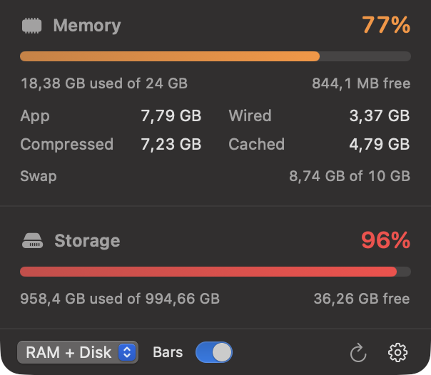

# MacosPanel

A small native macOS menu bar app that keeps RAM usage and free disk space visible at all times.




## Features

- Menu bar item with two live bars: RAM used (with its percentage) and storage used
  (with the free space in GB), tinted green / orange / red as usage grows.
- A **Bars** toggle in the panel footer switches the menu bar between that visualization
  (the default) and a plain text label.
- Click the item for a detail panel:
  - Memory used / free, App, Wired, Compressed, Cached, and swap.
  - Storage used / free for the boot volume plus any other local volumes.
- Green / orange / red gauges once memory or storage gets tight.
- Configurable refresh interval (1, 2, 5, or 10 seconds).
- Optional launch at login.
- No Dock icon: it lives only in the menu bar.

## Requirements

- macOS 14 (Sonoma) or newer
- Xcode command line tools (Swift 5.9+)

## Build and run

```bash
./build.sh run
```

Build only (creates `build/MacosPanel.app`):

```bash
./build.sh
```

## Install

```bash
cp -R build/MacosPanel.app /Applications/
open /Applications/MacosPanel.app
```

## Usage

- Click the menu bar item to open the panel.
- The picker in the panel footer chooses what the menu bar shows: RAM + Disk, RAM only, or Disk only.
- The **Bars** switch next to it toggles between the bar visualization (default) and a text label.
- The gear menu has the refresh interval, **Launch at Login**, and **Quit**.
- Preferences persist in `dev.olivermolnar.macos-panel`.

## How the numbers are calculated

- **Memory used** follows Activity Monitor: App + Wired + Compressed. Cached files are
  excluded from "used", and "free" is the remaining physical memory. Sample values come from
  `host_statistics64`, so no helper tools or `vm_stat` parsing are involved.
- **Swap** comes from `sysctl vm.swapusage`.
- **Disk free** uses `volumeAvailableCapacityForImportantUsage`, the same figure Finder shows,
  so purgeable space counts as free. The boot volume is always listed first.
- In the menu bar, both bars show **used** space. The RAM number is the used percentage; the
  storage number is the remaining free space.
- Values refresh every 2 seconds by default.

## Development

```bash
swift build
.build/debug/MacosPanel --preview-panel   # show the panel in a normal window
```

`build.sh` compiles the release binary, assembles the `.app` bundle (`LSUIElement`, so no Dock
icon), and ad-hoc signs it. Add an app icon by dropping an `.icns` into
`Contents/Resources` and referencing it from `CFBundleIconFile` in `build.sh` if you want one.

## Website

The marketing site lives in `site/` and is plain HTML/CSS/JS with no build step.
`.github/workflows/deploy-pages.yml` publishes it to GitHub Pages on every push to
`main` that changes `site/`.

One-time setup:

1. Open **Settings → Pages** in the GitHub repository.
2. Under **Build and deployment → Source**, pick **GitHub Actions**.
3. Push to `main` (or run the workflow manually). The site appears at
   <https://403access.github.io/macos-panel/>.

To preview locally:

```bash
cd site && python3 -m http.server 8000
```

If you add a custom domain, update the absolute URLs in `site/index.html` (canonical and
Open Graph tags) and the back-link in `site/404.html`.

## Notes

If **Launch at Login** reports an error, move the app to `/Applications` and try again. macOS
ties login items to a signed bundle in a stable location; running from the build folder is not
reliable.
