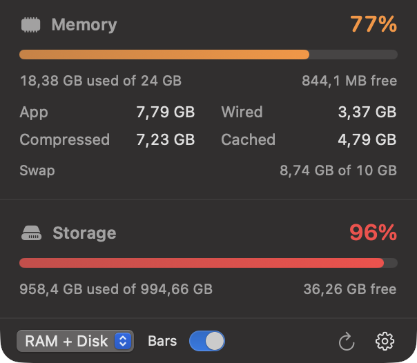

# MacosPanel

A small native macOS menu bar app that keeps CPU, RAM usage, and free disk space visible at all times.




## Features

- Menu bar item with live bars for CPU, RAM, and storage, tinted green / orange / red as
  usage grows. CPU and RAM show their percentage; storage shows the free space in GB.
  Optional SF Symbol icons identify each metric and are off by default.
- Optional charge bars for wireless accessories. Connected mice, keyboards, trackpads, and
  supported Logitech / Apple devices get their own bar, device icon, and percentage in the
  menu bar, plus a low-battery colour and a charging bolt. Device icons can be turned off
  with **Device Icons**.
- A **Menu Bar** menu in the panel footer chooses which of the three metrics appear, and a
  **Device Charge** submenu enables accessories individually or with **Show All Devices**.
- A **Bars** toggle switches the menu bar between that visualization (the default) and a
  plain text label.
- Click the item for a detail panel:
  - CPU used, User and System time, core count, and 1 / 5 / 15-minute load averages.
  - Memory used / free, App, Wired, Compressed, Cached, and swap.
  - Storage used / free for the boot volume plus any other local volumes.
  - Battery charge for connected wireless accessories, with a switch for each device.
- Green / orange / red gauges once CPU, memory, or storage gets tight.
- Configurable refresh interval (1, 2, 5, or 10 seconds).
- Optional launch at login.
- No Dock icon: it lives only in the menu bar.

## Requirements

- macOS 14 (Sonoma) or newer
- Xcode command line tools (Swift 5.9+)
- **Input Monitoring** permission if you want Logitech HID++ battery levels; Apple Magic
  accessories are read through the IORegistry and do not need it.

## Build and run

```bash
./build.sh run
```

Build only (creates `build/MacosPanel.app`):

```bash
./build.sh
```

## Install

```bash
cp -R build/MacosPanel.app /Applications/
open /Applications/MacosPanel.app
```

## Usage

- Click the menu bar item to open the panel.
- The **Menu Bar** menu in the panel footer toggles CPU, RAM, and Disk independently; at
  least one metric stays on unless a device charge is also shown.
- **Metric Icons** adds a CPU, memory-chip, or drive glyph in front of each metric. It is
  off by default and applies to both the bar and text styles.
- The same menu has a **Device Charge** submenu. Turn on individual accessories, or use
  **Show All Devices** / **Hide All Devices**. The panel's **Devices** section has the same
  switches next to each battery level. **Device Icons** hides the mouse / keyboard / trackpad
  glyph in the menu bar, leaving only the bar and percentage.
- The **Bars** switch next to it toggles between the bar visualization (default) and a text label.
- The gear menu has the refresh interval, **Launch at Login**, and **Quit**.
- Preferences persist in `dev.olivermolnar.macos-panel`.

## How the numbers are calculated

- **CPU usage** comes from `host_processor_info` (`PROCESSOR_CPU_LOAD_INFO`). Each refresh
  computes the busy share from the per-core tick deltas since the previous sample, so it
  reflects the last couple of seconds rather than the average since boot. The first sample
  falls back to the since-boot average. **User** includes nice time; **System** is kernel time.
- **Load average** comes from `getloadavg`, the same 1 / 5 / 15-minute figures `uptime` shows.
- **Memory used** follows Activity Monitor: App + Wired + Compressed. Cached files are
  excluded from "used", and "free" is the remaining physical memory. Sample values come from
  `host_statistics64`, so no helper tools or `vm_stat` parsing are involved.
- **Swap** comes from `sysctl vm.swapusage`.
- **Disk free** uses `volumeAvailableCapacityForImportantUsage`, the same figure Finder shows,
  so purgeable space counts as free. The boot volume is always listed first.
- In the menu bar, every bar shows **used** space. CPU and RAM show the used percentage; the
  storage number is the remaining free space.
- **Accessory charge** comes from the system rather than from polling a vendor app:
  Apple Magic Mouse / Keyboard / Trackpad values are read from the
  `AppleDeviceManagementHIDEventService` IORegistry nodes, and Logitech devices are queried
  over HID++ 2.0 (unified battery feature `0x1004`, legacy feature `0x1000`). The list is
  refreshed every 30 seconds on a background queue, so it does not add work to the 1–10
  second system sampling loop. Selected device IDs persist across launches and reconnects.
  Logitech HID++ needs **Input Monitoring** (System Settings → Privacy & Security → Input
  Monitoring); the panel shows an **Allow Access…** hint when it is missing. Grant it, then
  relaunch the app. Apple accessories do not need this permission.
- Values refresh every 2 seconds by default.

## Development

```bash
swift build
.build/debug/MacosPanel --preview-panel   # show the panel in a normal window
.build/debug/MacosPanel --print-devices   # list detected accessories and battery levels
```

`build.sh` compiles the release binary, assembles the `.app` bundle (`LSUIElement`, so no Dock
icon), and signs it. It uses the first available **Apple Development** or **Developer ID
Application** identity so Input Monitoring and other macOS grants survive rebuilds; set
`CODESIGN_IDENTITY` to choose a different identity. Without an identity it falls back to
ad-hoc signing, and macOS may require granting Input Monitoring again after every rebuild.
Add an app icon by dropping an `.icns` into `Contents/Resources` and referencing it from
`CFBundleIconFile` in `build.sh` if you want one.

## Website

The marketing site lives in `site/` and is plain HTML/CSS/JS with no build step.
`.github/workflows/deploy-pages.yml` publishes it to GitHub Pages on every push to
`main` that changes `site/`.

One-time setup:

1. Open **Settings → Pages** in the GitHub repository.
2. Under **Build and deployment → Source**, pick **GitHub Actions**.
3. Push to `main` (or run the workflow manually). The site appears at
   <https://403access.github.io/macos-panel/>.

To preview locally:

```bash
cd site && python3 -m http.server 8000
```

If you add a custom domain, update the absolute URLs in `site/index.html` (canonical and
Open Graph tags) and the back-link in `site/404.html`.

## Notes

If **Launch at Login** reports an error, move the app to `/Applications` and try again. macOS
ties login items to a signed bundle in a stable location; running from the build folder is not
reliable.
